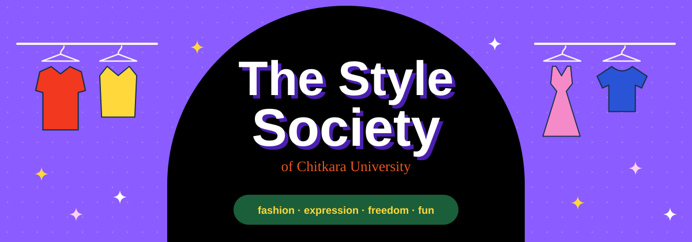

<div align="center">



<br>

### ✦ &nbsp;*Dressed to express. Built to be seen.*&nbsp; ✦

**The official website of The Style Society, Chitkara University's home for fashion, expression, creativity, the high-life, freedom and fun.**

<br>


<br><br>

**[✦ Live Site](#-live-site)** &nbsp;·&nbsp; **[The Society](#-the-society)** &nbsp;·&nbsp; **[What's Inside](#-whats-inside)** &nbsp;·&nbsp; **[Design Language](#-design-language)** &nbsp;·&nbsp; **[Run It](#-run-it)** &nbsp;·&nbsp; **[Still In Production](#-still-in-production)**

</div>

<br>

---

<br>

## ✦ Live Site

[the-style-society.netlify.app](https://the-style-society.netlify.app/)

<br>

## ✦ The Society

**The Style Society** is Chitkara University's home for people who treat getting dressed as an art form.

We are dedicated to **fashion**, **expression** and **creativity**; to **the high-life** with its glamour, its gloss and its grand entrances; and to the **freedom and fun** of becoming exactly who you want to be.

<div align="center">

*Founded by*

## ✦ Parneet ✦

</div>

This repository holds The Society's website: a bold, poster-inspired, fully responsive site that works like a creative studio's portfolio rather than a club notice board.

<div align="center">

*Website by*

## ✦ Kheetansh Bansal ✦

</div>


<br>

## ✦ What's Inside

| Section | What it does |
|---|---|
| **Hero** | A black arch on a purple field, taken straight from the hiring poster, with a rail of garments that sway on their hangers. |
| **About** | The Society's story, the founder's name in script, and a rotating badge. |
| **Five things we live for** | Arch-topped colour cards for *Fashion, Expression, Creativity, The High-Life* and *Freedom and Fun*. |
| **Runway Calling** | A full illustrated clothes rack. Poke a hanger and it swings. |
| **On the calendar** | Poster-style event cards whose status updates itself: *Happening today*, *In N days* or *Wrapped*. |
| **Countdown** | A live clock to the next event. |
| **Founder** | A dedicated spotlight for Parneet. |
| **Join us** | An application form for new members. |
| **Footer** | An edge-to-edge outlined wordmark that fits every screen. |

**Small touches:** two scrolling ribbons, sparkles that burst wherever you click, a mobile slide-down menu, and keyboard-friendly focus rings.

<br>

## ✦ Design Language

Everything on the site comes from the society's posters and creativity, then pushed further.

### Palette

| Swatch | Name | Hex | Where it shows up |
|:---:|---|---|---|
|  | Runway Purple | `#8B5CFF` | Hero field, hiring poster |
|  | Deep Purple | `#4A1FB0` | Headline shadows, button shadows |
|  | Ink | `#000000` | Arches, dark sections |
|  | Spotlight Yellow | `#FFD93B` | Buttons, ribbons, highlights |
|  | Statement Red | `#F2391F` | "Calling", jackets, script accents |
|  | Burnt Orange | `#E8571F` | Hero subtitle |
|  | Hot Pink | `#E94BB0` | "Attention Seeking", footer outline |
|  | Blush | `#FCD0EC` | Runway section |
|  | Emerald | `#1B5E3A` | Hiring pill, countdown |
|  | Paper | `#F6F3EF` | Light backgrounds |

### Typography

| Role | Font | Used for |
|---|---|---|
| Display | **Abril Fatface** | Section headlines, the high-fashion voice |
| Body | **Outfit** | Everything readable, plus the heavy hero title |
| Hand-drawn | **Londrina Solid** | The "Attention Seeking" poster lettering |
| Script | **Mrs Saint Delafield** | Parneet's signature and the event dates |

### Illustration

Every garment (jackets, coats, vests, trousers, dresses, tees, shoes and the hat) is hand-built **inline SVG** with a halftone texture, so there are no image files to load and the artwork stays sharp at any size.

### Motion

Motion is used where it tells you something: the hero builds in once on load, garments sway on their hangers, hangers swing when touched, ribbons scroll, and the countdown ticks. Visitors who prefer reduced motion get a calm version automatically.

<br>

## ✦ Run It

There is nothing to install and nothing to build.

```bash
# 1. Clone the repo
git clone https://github.com/your-username/your-repo.git
cd your-repo

# 2. Open the site
open index.html          # macOS
start index.html         # Windows
xdg-open index.html      # Linux
```

Prefer a local server?

```bash
python -m http.server 8000
# then visit http://localhost:8000
```

> **Heads up:** the site loads its fonts from Google Fonts, so connect to the internet the first time you open it. Without a connection it falls back to system fonts.

<br>

## ✦ Still In Production

<b>Updating the events and countdown</b>


<b>Connecting the application form</b>

<b>Refining the colours</b>

<b>Adding social links and additional content</b>

<br>

With time, we hope that both The Society's history as well as its website will be more colorful and beautiful.

<br>

## ✦ Project Structure

```
The-Style-Society/
├── index.html          
├── assets/
│   └── banner.svg     
└── README.md
```

<br>

## ✦ Built With

- **HTML5**, using semantic landmarks and ARIA labels
- **CSS3** with custom properties, Grid, Flexbox, `clamp()` fluid sizing and keyframe animation
- **Vanilla JavaScript** for the countdown, event status, mobile menu, form and click sparkles
- **Inline SVG** for all illustration
- **Google Fonts** for typography

No frameworks, no build step, no `node_modules`.

<br>

## ✦ Credits

- **Founder:** Parneet
- **Website:** Kheetansh Bansal

<br>

<div align="center">

---

<br>

### ✦ &nbsp;Together, let's raise the bar.&nbsp; ✦

<sub>Made with colour, confidence and far too many outfit changes.</sub>

</div>